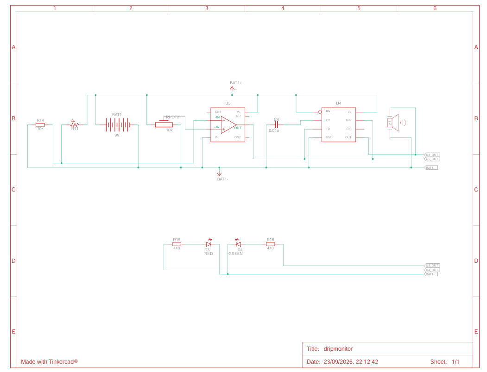
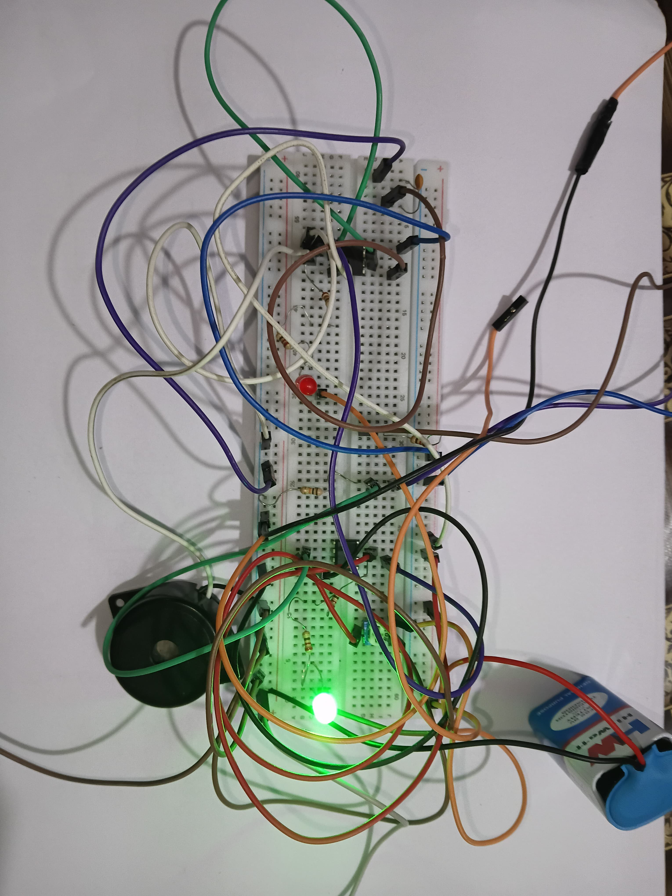
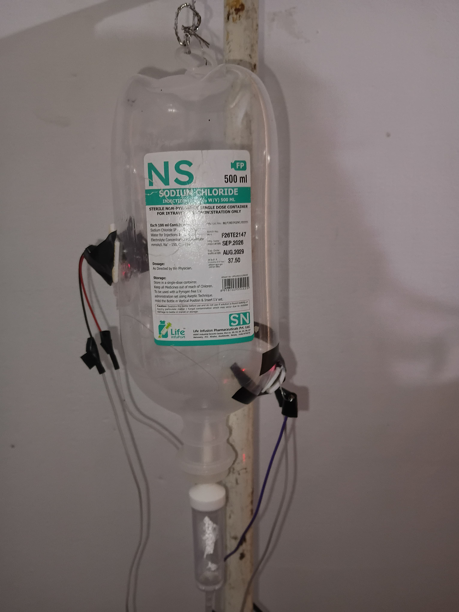

# ANALOG DRIP MONITORING SYSTEM
Analog drip monitoring system is a IV fluid monitoring system which uses no microcontroller or code.It only makes use of basic analog devices like op-amp 741 and 555 timer IC.

## HOW IT WORKS
- The drip monitoring system uses a laser light and LDR as the initial stage which determines whether the drip bottle is empty or not with the help of refractive index of drip solution.
- When the drip bottle is not empty, the refractive index of solution makes the laser light to bend and it doesn't hit the LDR. Therefore the resistance of LDR is high and the voltage tapped out from it via a voltage divider is less.
- When the drip bottle is empty, there is no medium to bend the laser light thus it directly hits the LDR and the resistance of LDR decreases significantly and the voltage tapped out is high.
- Tapped out voltage is given to the inverting terminal of OP Amp 741, which acts as a comparator.
- Output of OP amp 741 IC is then given to 555 Timer IC which acts as a Schmitt Inverter.

## FEATURES
- No microcontroller like esp32,arduino,rasberry pi is required.
- Uses only analog devices.
- No software latency.
- Low cost setup and implemetation.
- Prevents blood reflux.
- Audio and Visual Feedback for bystanders and nursing staffs.

## HARDWARE USED
- OP Amp 741 IC
- 555 Timer IC
- 9V Power Supply
- Resistors(10k ohms,2*440 ohms)
- capacitor(0.01uF)
- potentiometer(10K ohm)
- LDR
- Active Buzzer 
- LED's

## SIMULATION

### Circuit diagram

**Tinkercad Circuit**

### Simulation Video
[click here to watch software simulation](https://drive.google.com/file/d/1NfZoWIkqWcGQ_9SkQt4M_cjl5xFKhbEM/view?usp=sharing)

**Tinkercad simulation video**

## HARDWARE IMPLEMENTATION

### Circuit Setup

**Circuit setup on breadboard**

### Drip Bottle Setup

**Laser and LDR embedded on drip bottle**

### Working video
[click here to watch hardware implementation](https://drive.google.com/file/d/1EslWw56p1TW5zF5KSSKKYSBs9fpPgyEx/view?usp=sharing)

**hardware implementation video**

## SOFTWARE SIMULATION LINK
[click to simulate project using tinkercad](https://www.tinkercad.com/things/4KfzQUNFcQJ-dripmonitor)
